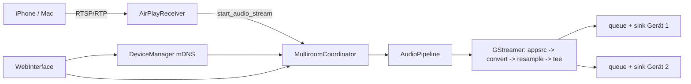
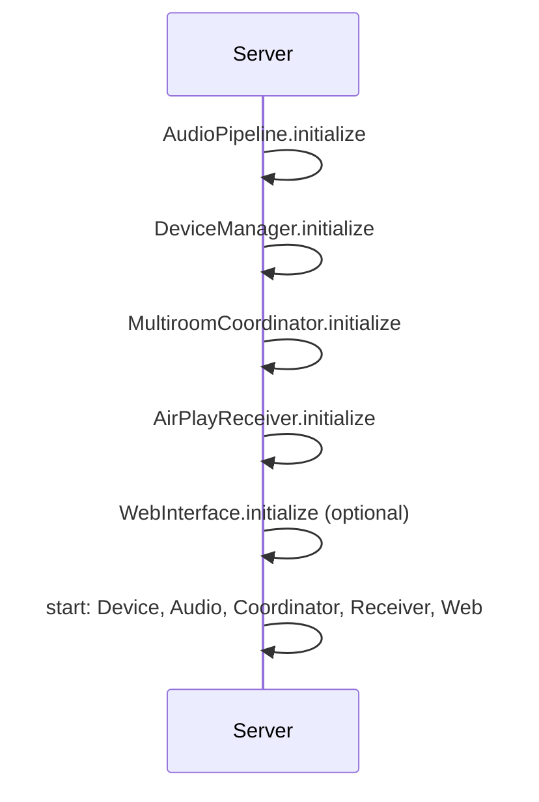

# Architektur

[← Zurück zur README](../README.md)

## Überblick

Der Server empfängt AirPlay-Audio (RAOP/RTSP), verarbeitet es mit GStreamer und verteilt es über einen Koordinator an mehrere AirPlay-Zielgeräte. Alle Komponenten laufen asynchron in einem `asyncio`-Event-Loop; die Audio-Verarbeitung nutzt zusätzlich einen eigenen Thread.

## Komponenten

| Komponente | Datei | Aufgabe |
|---|---|---|
| Hauptklasse `AirPlayMultiroomServer` | `src/__init__.py` | Initialisiert, startet und stoppt alle Komponenten, Logging, Signal-Handling, CLI (`--config`, `--debug`) |
| ConfigManager | `src/config_manager.py` | Lädt YAML, merged mit Defaults, Zugriff per Punkt-Notation, Validierung |
| AirPlayReceiver | `src/airplay_receiver.py` | TCP/RTSP-Server (OPTIONS, ANNOUNCE, SETUP, RECORD, FLUSH, TEARDOWN) |
| AudioPipeline | `src/audio_pipeline.py` | Streams, thread-sichere Puffer, GStreamer-Pipeline (appsrc → audioconvert → audioresample → tee) |
| DeviceManager | `src/device_manager.py` | mDNS-Erkennung und Verbindungsmanagement (Inhalt nicht einsehbar, Annahme laut README) |
| MultiroomCoordinator | `src/multiroom_coordinator.py` | Synchronisation und Verzögerungen (Annahme laut README) |
| WebInterface | `src/web_interface.py` | Optionales Web-UI (`web.enabled`) |

## Datenfluss

## Start-Reihenfolge

Das Stoppen erfolgt in umgekehrter Reihenfolge.

## Audio-Pipeline

- `AudioStream` kapselt Parameter (Samplerate, Kanäle, Bittiefe) und einen `AudioBuffer` (deque, max. 1024 Einträge). Ein Stream gilt nach 5 s ohne Daten als inaktiv.
- Ein Processing-Thread holt Daten des aktiven Streams, schiebt sie in GStreamer und ruft registrierte Output-Callbacks auf.
- Outputs werden dynamisch über `tee`-Request-Pads mit je einer Queue (2 s) angehängt.

## Bekannte Lücken (aus dem Code abgeleitet)

- RSA-Schlüssel im Empfänger ist ein Platzhalter, SDP-Parsing und mDNS-Registrierung sind TODO.
- `src/__init__.py` enthält vorangestellte Shell-Befehle und ist so nicht importierbar; `src/__main__.py` fehlt im Dateibaum.

## Deployment

systemd-Dienst `airplay-multiroom-server` unter Benutzer `airplay`, Installation in `/opt/airplay-multiroom-server`, Konfiguration in `/etc/airplay-multiroom`, Logs in `/var/log/airplay-multiroom`.
